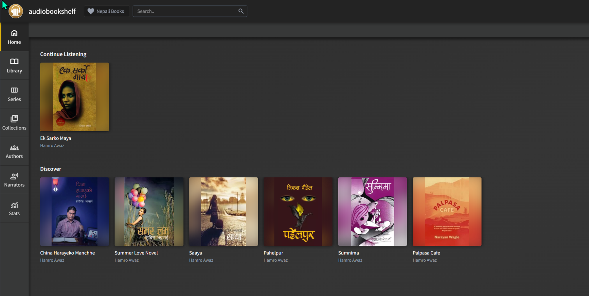

# Audiobookshelf

A self-hosted audiobook and podcast server, [Audiobookshelf](https://www.audiobookshelf.org), running in a small LXC container on my Proxmox cluster. I use it mainly for Nepali audiobooks: listening progress syncs between the phone app and the browser, and it remembers where I stopped.

## The container

| Setting | Value |
|---|---|
| Type | LXC, Debian 13 (trixie) |
| Created with | The **Proxmox VE community script** for Audiobookshelf (tags `audiobook`, `community-script`, `podcast`) |
| CPU / RAM / disk | 2 vCPU, 2 GB, 12 GB |
| Port | `13378` (web UI and API) |
| Start at boot | Yes |

## Build

1. On a Proxmox node shell, run the community-scripts Audiobookshelf installer (from [community-scripts.github.io/ProxmoxVE](https://community-scripts.github.io/ProxmoxVE/)). Choose **Advanced** to set the container ID, a static IP / DHCP reservation, CPU, RAM and disk. Read any script before running it as root.
2. Open `http://<container-ip>:13378`, create the root user, then create a normal user for day-to-day listening.
3. **Libraries:** add a library (type *Book*), point it at the audiobook folder, and let it scan. One folder per book (`Author/Title/…mp3`) gives the cleanest matching.
4. **Apps:** install the Audiobookshelf app on Android/iOS and log in with the server address. Outside the house, connect over the home WireGuard VPN ([unifi-network](https://github.com/nashibbhattrai766-max/unifi-network)).

## Monitoring and backups

- **Zabbix** web check on port 13378 every minute; shown on the rack screen's Status and Reliability pages ([zabbix-monitoring](https://github.com/nashibbhattrai766-max/zabbix-monitoring)).
- A Zabbix trigger also reports when the container restarts.
- The whole container is backed up nightly to **Proxmox Backup Server** ([proxmox-backup-server](https://github.com/nashibbhattrai766-max/proxmox-backup-server)), including the library metadata and listening progress.

## Lessons learned

- **Acknowledge "restarted" alerts in Zabbix instead of closing them.** Closing one by hand while uptime is still under 10 minutes makes it fire again.
- If the server is unreachable but the container shows "running", check the service inside it: `pct exec <id> -- systemctl status audiobookshelf`.

## License

MIT
